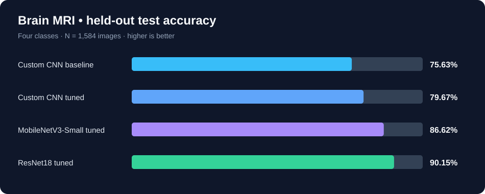

# Brain MRI Classification — CNN & Transfer Learning

**Research-oriented computer vision project:** сравнительный анализ собственных свёрточных нейросетей и transfer learning для классификации МРТ головного мозга.

[](#технологии) [](#технологии) [](https://colab.research.google.com/github/Vlad-gw/cnn_in_medicine/blob/main/notebooks/brain_mri_cnn_experiments.ipynb)  

> **Главное:** обучена собственная CNN с нуля, проведены 9 конфигурационных экспериментов и выполнен сравнительный анализ с ResNet18 и MobileNetV3-Small. Лучшая модель — fine-tuned ResNet18: **90,15% Accuracy** и **89,93% Macro-F1** на 1 584 тестовых изображениях.

[**▶ Открыть ноутбук в Google Colab**](https://colab.research.google.com/github/Vlad-gw/cnn_in_medicine/blob/main/notebooks/brain_mri_cnn_experiments.ipynb) · [Методология и воспроизведение](docs/reproducibility.md) · [Подробные результаты](docs/experiments.md)

## Зачем этот проект

МРТ содержит сложные визуальные структуры, которые трудно описать ручными признаками. Цель исследования — изучить, как архитектура CNN, регуляризация, аугментация и перенос обучения влияют на способность модели **различать четыре категории снимков**:

- **Glioma** — глиома;
- **Meningioma** — менингиома;
- **No tumor** — отсутствие опухоли;
- **Pituitary** — опухоль гипофиза.

Это **исследовательский прототип**, не система медицинской диагностики. Метрики получены на публичном датасете; клиническая надёжность, независимость пациентов и переносимость на другие медицинские центры не подтверждены.

## Основные результаты

| Модель | Accuracy на Test | Macro-F1 на Test |
|:--|--:|--:|
| Собственная CNN (baseline) | 75,63% | 74,51% |
| Собственная CNN (fine-tuned) | 79,67% | 79,30% |
| MobileNetV3-Small (fine-tuned) | 86,62% | 86,09% |
| **ResNet18 (fine-tuned)** | **90,15%** | **89,93%** |



**Что удалось улучшить:** собственная CNN выросла на **+4,04 процентного пункта Accuracy** после продолжения обучения с уменьшенным learning rate и аугментацией. Fine-tuned ResNet18 превзошла исходную CNN на **+14,52 п. п.**

**Что пока работает хуже:** лучший классификатор распознал глиому в **296 из 386 случаев** (Recall **76,7%**); наиболее частая ошибка — **глиома → менингиома** (66 случаев). Это важное ограничение, а не просто «высокая общая точность».

## Что я реализовал

- Спроектировал **собственную CNN из четырёх свёрточных блоков** (32 → 64 → 128 → 256 фильтров, ReLU, MaxPooling, Global Average Pooling).
- Построил единый экспериментальный pipeline для данных, обучения, метрик и графиков.
- Проверил **Batch Normalization, Dropout и data augmentation**.
- Сравнил обучение **с нуля** с **переносом обучения ImageNet** на ResNet18 и MobileNetV3-Small.
- Провёл **fine-tuning последних блоков** готовых моделей; использовал checkpoint лучшего состояния по validation loss и Early Stopping.
- Посчитал **Accuracy, Precision, Recall, Macro-F1** и матрицы ошибок; исследовал проблемные классы.
- Проверил точные дубликаты через SHA-256 и организовал раздельные train / validation / test.

## Как устроены эксперименты

**9 экспериментов:** `cnn_baseline`, `cnn_bn`, `cnn_bn_dropout`, `cnn_bn_dropout_aug`, `resnet18`, `mobilenet_v3_small`, `cnn_finetuned`, `resnet18_tuned`, `mobilenet_v3_small_tuned`.

Первые 7 сравнивают архитектуры и способы регуляризации; ещё 2 — дополнительное размораживание и обучение последних блоков transfer-моделей. Итоговая оценка четырёх кандидатов выполнена на одинаковом тестовом наборе. Подробности — в [документации экспериментов](docs/experiments.md).

## Данные и протокол

Источник: [Brain Tumor MRI Dataset — Kaggle](https://www.kaggle.com/datasets/masoudnickparvar/brain-tumor-mri-dataset).

| Параметр | Значение |
|:--|:--|
| Train | 2 800 изображений (по 700 на класс) |
| Validation | 400 изображений (по 100 на класс) |
| Test | 1 584 изображения после исключения 16 точных дубликатов |
| Вход | RGB, 160×160 |
| Batch size / seed | 32 / 42 |
| Среда | Python, PyTorch, Google Colab (GPU T4) |
| Loss / optimizer | CrossEntropyLoss / AdamW |
| Ограничение | Эксперименты проводились с ограниченным бюджетом обучения (~30 минут) |

Использована **часть доступного обучения** ради ограничения времени; исходный Testing не применялся для выбора гиперпараметров. Исключение точных дубликатов **не гарантирует** отсутствие близких изображений или одних и тех же пациентов в разных частях датасета.

## Быстрый запуск

1. Откройте [**ноутбук в Google Colab**](https://colab.research.google.com/github/Vlad-gw/cnn_in_medicine/blob/main/notebooks/brain_mri_cnn_experiments.ipynb).
2. Выберите среду выполнения **GPU** (при наличии — T4).
3. Выполните ячейки последовательно или **«Выполнить все»**; при необходимости разрешите подключение Google Drive.
4. Ноутбук загрузит открытый датасет через `kagglehub`. Если автоматическая загрузка недоступна — скачайте его вручную и задайте `MANUAL_DATASET_PATH` в настройках.
5. Таблицы, графики, веса и сводка сохраняются в `MyDrive/LR3_variant24_CNN_MRI/`.

> Обучение может занять больше времени в зависимости от GPU, доступности Kaggle и лимитов Colab. Исходные обученные веса **не включены** в репозиторий; результаты здесь задокументированы по завершённому запуску. Для их воспроизведения требуется обучение моделей.

## Структура репозитория

```text
cnn_in_medicine/
├── notebooks/
│   └── brain_mri_cnn_experiments.ipynb   # Полный Colab pipeline и 9 экспериментов
├── assets/
│   └── model_comparison.svg              # Визуальное сравнение на тесте
├── docs/
│   ├── experiments.md                    # Таблицы, интерпретация и ошибки
│   └── reproducibility.md                # Данные, запуск, ограничения
├── requirements.txt                      # Основные Python-зависимости
├── .gitignore
├── LICENSE
└── README.md
```

## Технологии

**Python · PyTorch · torchvision · transfer learning · CNN · scikit-learn · NumPy · pandas · Matplotlib · Seaborn · Google Colab · KaggleHub**

## Для обсуждения на собеседовании

Проект показывает не только обучение моделей, но и **постановку ML-эксперимента**: общие данные и метрики, корректное разделение выборки, контроль утечек, настройку гиперпараметров, сравнение baseline и fine-tuning, интерпретацию ошибок и честное описание ограничений.

**Куда развивать:** увеличить объём train, проверить patient-level split, провести внешнюю валидацию, сравнить обучение при 160×160 и 224×224, отдельно оптимизировать Recall глиомы.

---

**Автор:** [Vladislav Gavrilov](https://github.com/Vlad-gw) · **Формат:** учебно-исследовательский проект в области Computer Vision / Medical Imaging.

**Disclaimer:** результаты не предназначены для самостоятельной постановки диагноза или медицинского использования.
